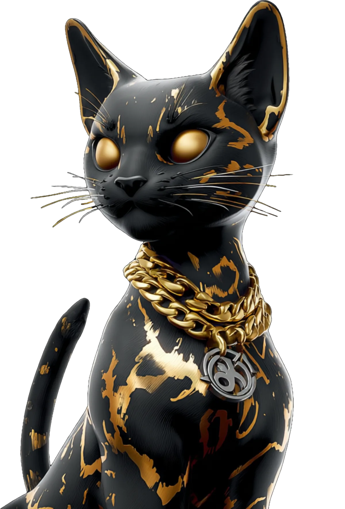

<!--
  ┌─────────────────────────────────────────────────────────────────────┐
  │  GENERATED FILE — do not edit this README by hand.                  │
  │  Edit  data/profile.json · data/properties.json · the template,     │
  │  then run:   node scripts/build-profile.mjs                         │
  │  (the GitHub Action rebuilds it automatically on push to main).     │
  └─────────────────────────────────────────────────────────────────────┘
-->

<div align="center">


<em>Client builds, shipped from one desk — agents carry the work, the work funds the machine.</em>


<table>
  <tr>
    <td align="center" width="430" valign="top">
      <br/>
      <br/>
      <sub>PRODUCER · ENGINEER · THE ONE WHO SHIPS</sub>
    </td>
    <td align="center" width="430" valign="top">
      <br/>
      <br/>
      <sub>CHIEF QUALITY BENGAL · STUDIO ENFORCER</sub>
    </td>
  </tr>
</table>


### The roster

| Property | Type | Live at | Status | Build |
|:--|:--|:--|:--:|:--:|
| **Deep Productions** | Recording studio | [deep.productions ↗](https://deep.productions) | 🟢 Live | `DEEP-PRODUCTIONS` |
| **Lukas Rossi** | Rock artist | [lukasrossionline.com ↗](https://www.lukasrossionline.com) | 🟢 Live | `LUKASROSSI.ONLINE` |
| **3rd Charm** | Tampa rock band | [3rd-charm.vercel.app ↗](https://3rd-charm.vercel.app) | 🟡 Building | `3RD-CHARM-MUSIC` |
| **Applegate** | Designer swim | [applegate.vercel.app ↗](https://applegate.vercel.app) | 🟡 Building | `APPLEGATE` |
| **Sober Lyfe** | Treatment | sl-treatment | 🔵 Soon | `SL-TREATMENT` |

<sub>🟢 Live&nbsp;&nbsp;·&nbsp;&nbsp;🟡 Building&nbsp;&nbsp;·&nbsp;&nbsp;🔵 Soon&nbsp;&nbsp;—&nbsp;&nbsp;names link to the live site.</sub>

<br/>

```text
╔══════════════════════════════════════════════════════╗
║   CLIENT BUILDS ONLY · NO SIDE PROJECTS IN THE HUB   ║
║   MAIN IS SACRED · THREE TREES MAX · MERGE OR DIE    ║
╚══════════════════════════════════════════════════════╝
```

<br/>


<sub>CLIENT WORK · THE ARCHITECT BUILDS HERE · HIRE&nbsp;→&nbsp;<a href="https://www.savage.ceo">savage.ceo</a></sub>

<sub><a href="https://github.com/savageceo">SAVAGE CEO</a>&nbsp;&nbsp;·&nbsp;&nbsp;<a href="https://github.com/SAVAGE-STUDIO-INC">SAVAGE STUDIO</a>&nbsp;&nbsp;·&nbsp;&nbsp;<a href="https://github.com/SAVAGE-ROSTER">SAVAGE ROSTER</a>&nbsp;&nbsp;·&nbsp;&nbsp;<a href="https://github.com/SAVAGE-SUITE">SAVAGE SUITE</a>&nbsp;&nbsp;·&nbsp;&nbsp;<a href="https://github.com/SAVAGE-CITY">SAVAGE CITY</a>&nbsp;&nbsp;·&nbsp;&nbsp;<a href="https://github.com/SAVAGE-BUNNY">SAVAGE BUNNY</a>&nbsp;&nbsp;·&nbsp;&nbsp;<b>SAVAGE CLIENTS</b>&nbsp;&nbsp;·&nbsp;&nbsp;<a href="https://github.com/GHOST-CROWN">GHOST CROWN</a></sub>

<p>
  <a href="https://github.com/SAVAGE-CLIENTS"></a>
</p>

</div>
